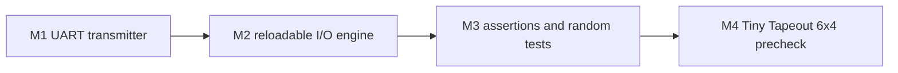

# Protocol Emulator ASIC

Cycle-accurate 8-N-1 UART transmitter in SystemVerilog, checked on every clock by a self-checking Verilator testbench.

This is milestone 1 of a Jane Street ASIC-competition entry: a small programmable I/O engine for UART, SPI, and I2C, aimed at the IHP 130nm process through Tiny Tapeout. Only the transmitter is implemented. It is simulated, not synthesized, and not a programmable engine yet.

- Clock: 100 MHz
- Baud: 115200, divider 868, actual 115207.4 (0.0064%, 64 ppm)
- Frame: 10 bits, 8680 clocks, 86.8 µs
- Last run: `make verify`, 2026-10-27: 34 frames, 0 errors

Design notes: [docs/README.md](docs/README.md). Milestone evidence: [docs/milestones.md](docs/milestones.md). Competition constraints: [docs/competition.md](docs/competition.md).

## Quick start

```sh
make lint      # Verilator -Wall on the RTL
make sim       # build and run the self-checking testbench
make verify    # lint, then sim
make docs      # render WaveDrom JSON in docs/wavedrom/ to docs/img/
```

XSIM commands are in the [Makefile](Makefile) header. The recorded result is Verilator.

## Roadmap

Each step is verified before the next one adds architecture. Later boxes are not started. Rules for the later steps are in [docs/competition.md](docs/competition.md).



- **Milestone 1: Baseline PHY.** Fixed-function 8-N-1 UART transmitter ([src/uart_tx.sv](src/uart_tx.sv)), simulated. Spec: [docs/uart_tx.md](docs/uart_tx.md).
- **Milestone 2: Reloadable I/O engine.** Tiny Tapeout pin shell (`clk`, `rst_n`, 8 inputs, 8 outputs, 8 bidirectional), a program the host loads and reloads after reset, an assembler, and one UART transmit program. The instruction set is general pin I/O, so SPI and I2C are later programs on that engine. Not started.
- **Milestone 3: Stronger verification.** Assertions, then broader random tests. Formal proof only after a property has actually been proved. Not started.
- **Protocols before submission.** After the engine simulates: example programs for SPI modes 0–3 and I2C at 100 kHz and 400 kHz. Low-speed USB and 10 Mbit Ethernet are stretch goals after a passing 6x4 precheck.
- **Milestone 4: Tiny Tapeout 6x4 precheck.** CMOS5L flow on a 6x4 tile. Local hardening if GitHub Actions hits the 6-hour limit. An IHP SRAM macro stays unused until the engine's memory does not fit in the tile. Not started.
