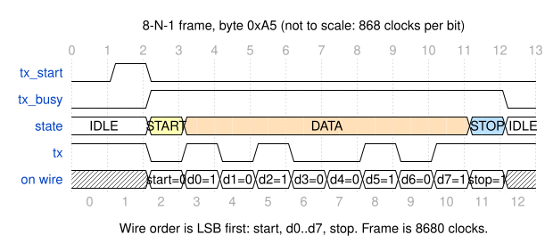
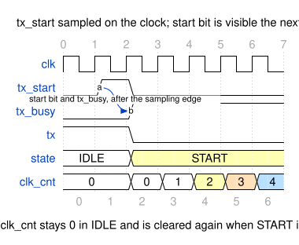
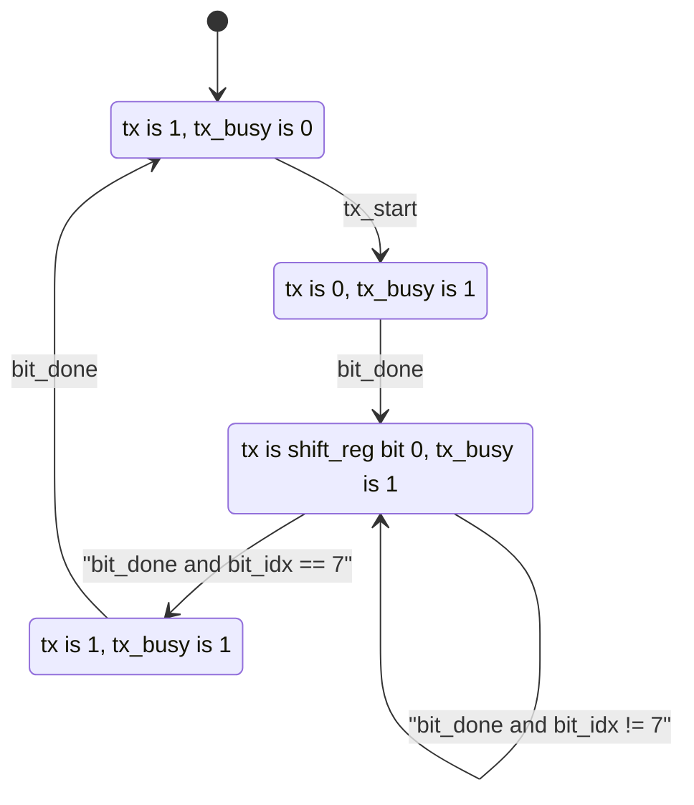
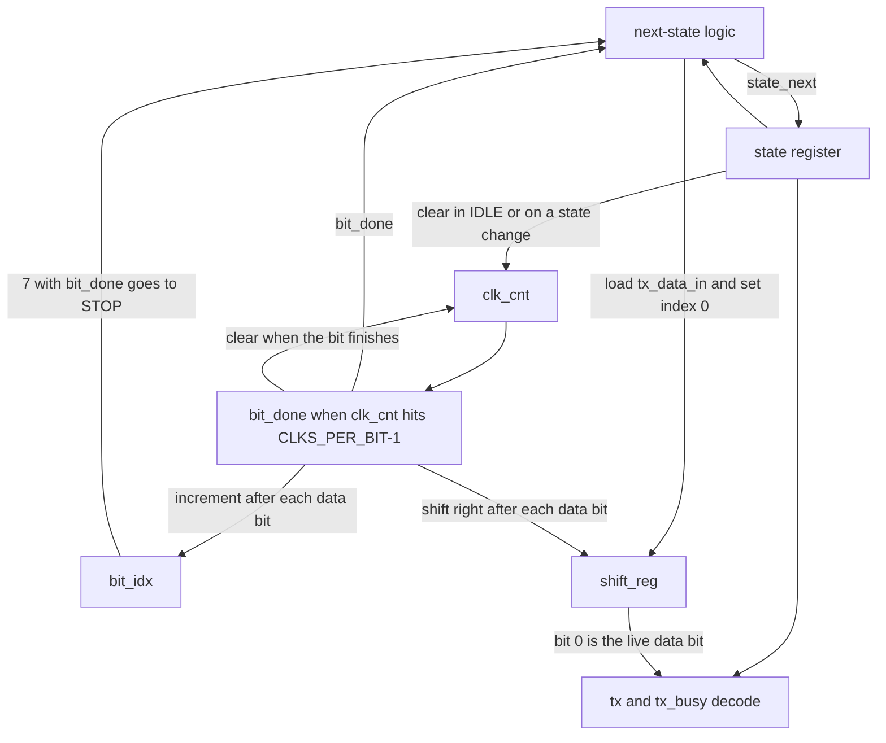

# UART transmitter

Fixed-function 8-N-1 transmitter in [src/uart_tx.sv](../src/uart_tx.sv). This is the Milestone 1 PHY: one byte in, one frame on a pin. It is not programmable.

## Interface

| Port | Dir | Width | Meaning |
| --- | --- | --- | --- |
| `clk` | in | 1 | 100 MHz clock |
| `rst_n` | in | 1 | Asynchronous, active-low. Returns the line to idle |
| `tx_start` | in | 1 | Request. Honored only in IDLE. Use a 1-cycle pulse |
| `tx_data_in` | in | 8 | Byte captured on the edge that accepts `tx_start` |
| `tx` | out | 1 | Serial line. Idle level is 1 |
| `tx_busy` | out | 1 | 0 in IDLE, 1 for the whole frame |

`tx_start` is level-sensitive in IDLE. Holding it high starts another frame as soon as the previous one returns to IDLE. The testbench always pulses it for one cycle.

The byte is copied into `shift_reg` on that accept edge. Later changes on `tx_data_in`, and further `tx_start` pulses while busy, do not change the frame already in flight.

## Baud

`CLKS_PER_BIT` defaults to 868.

| Quantity | Value |
| --- | --- |
| Clock | 100 MHz |
| Target baud | 115200 |
| Divider | round(100e6 / 115200) = 868 |
| Actual baud | 100e6 / 868 ≈ 115207.4 |
| Error | 0.0064% (64 ppm) |
| One bit | 868 clocks (8.68 µs) |
| One frame | 10 × 868 = 8680 clocks (86.8 µs) |

`bit_done` is `clk_cnt == CLKS_PER_BIT - 1`. The counter is not free-running. It is cleared to 0 while IDLE, when the next state differs from the current state, and when a bit finishes (including between data bits, where the state stays DATA).

64 ppm is far from the roughly 2% total baud error a typical UART link tolerates. There is no single numbered UART baud spec behind that figure.

## Frame

On `tx`, LSB first:

1. Start bit, 0, for 868 clocks
2. Data bits `d0` .. `d7`, each 868 clocks
3. Stop bit, 1, for 868 clocks

The line is 1 before the frame and 1 again on the cycle after the stop bit, when `tx_busy` falls.

`0xA5` is `10100101`. LSB first, the data bits on the wire are 1, 0, 1, 0, 0, 1, 0, 1. The picture is one cell per bit, not one cell per clock.

## Handshake

`tx_start` is sampled on a rising edge while the state is still IDLE. The state register updates on that edge, so `tx_busy` and the start bit are visible on the following cycle. `clk_cnt` is 0 in IDLE and is cleared again on the entry to START, then counts 1, 2, 3...

## FSM

Four states. Outputs are a combinational decode of the registered state (Moore). `tx` is 1 in IDLE and STOP, 0 in START, and `shift_reg[0]` in DATA.

The state encoding is 2 bits, and all four values are used. The `default` arm in the case still returns to IDLE with `tx` high, so an X or a bad encoding cannot stick the line low.

## Datapath

Registers (`state`, `clk_cnt`, `bit_idx`, `shift_reg`) update in one `always_ff`. Next-state and the Moore outputs are one `always_comb`, with defaults assigned before the case so none of those signals infers a latch.

`shift_reg` shifts right, so bit 0 is always the next data bit. That is LSB first. A left shift would put the bytes out backwards; the testbench's mutation check covers that.

## Notes for later

- `tx` and `tx_busy` are a combinational decode of the registered state. `START` is `01` and `DATA` is `10`, so that transition flips both state bits. If the first data bit is 0, skew can glitch `tx` high at the bit edge. `STOP` (`11`) to `IDLE` (`00`) can pass through `START` and glitch `tx` low. A UART samples near the middle of the 8.68 µs bit, so the glitch is far from the sample point. Registering `tx` is the cleanup before this pin is used on a chip. It is not done in this milestone: the bench is cycle-accurate to the Moore timing.
- Nothing here is an instruction set, a bus, or a synthesized netlist. Those are later milestones and are not claimed by this page.
