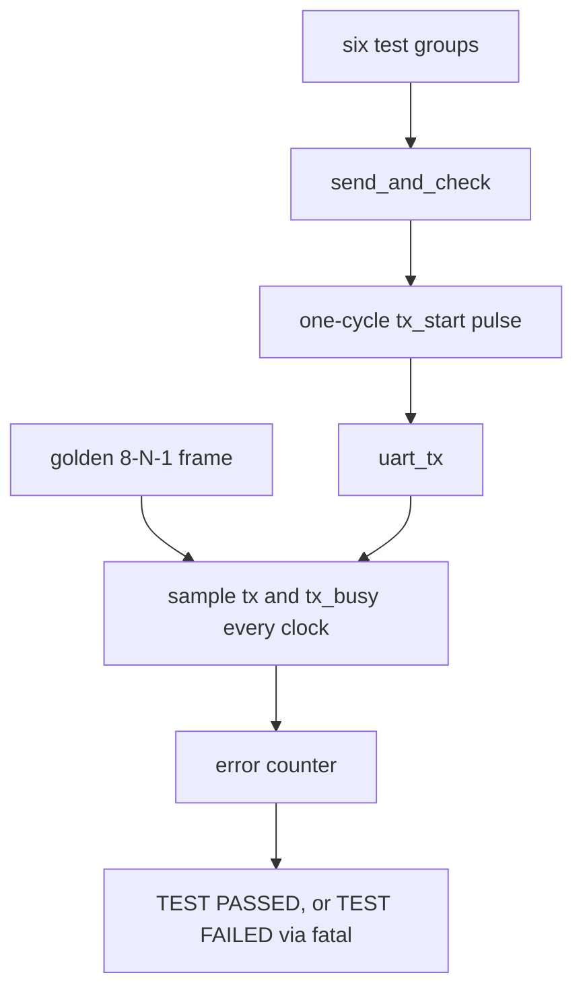

# Verification

Self-checking simulation of [src/uart_tx.sv](../src/uart_tx.sv) by [tb/uart_tx_tb.sv](../tb/uart_tx_tb.sv). No UVM, no classes, no simulator-specific constructs. The bench is standard SystemVerilog, written to run under Verilator and under Xilinx XSIM. The recorded result is Verilator.

This is directed and lightly random simulation. It is not formal verification. Assertions are Milestone 3.

## What the bench checks

Stimulus changes on `negedge clk`. The DUT samples on `posedge clk`. Outputs are read on `negedge clk`, so the bench never races the DUT.

The golden frame is `{stop, data[7:0], start}` = `{1, data, 0}`, sent from index 0. For every one of the 8680 clocks the bench requires `tx` to equal that bit and `tx_busy` to be 1. The clock after the stop bit must have `tx == 1` and `tx_busy == 0`. One loop therefore checks the value, LSB-first order, and the exact bit width. An early or late edge fails.



A watchdog `$fatal`s if the run exceeds 20 ms, so a stuck FSM cannot spin forever. The first 40 mismatches print time, expected, and actual. Further prints are suppressed. The run stops after 200 errors.

## Tests

| # | Group | What a failure means |
| --- | --- | --- |
| 1 | Reset, then 2000 idle clocks | Line not high, or `tx_busy` stuck, or a spontaneous frame |
| 2 | `00 FF 55 AA 01 80 A5` | Wrong level, wrong bit order, or wrong bit width. `01` vs `80` separates LSB-first from MSB-first |
| 3 | Five back-to-back frames. The bench inserts no extra wait. The FSM still spends one clock in IDLE between frames, because `tx_start` is sampled only in IDLE | Counter, `bit_idx`, or `shift_reg` not restarting |
| 4 | `tx_start` and a different `tx_data_in` while busy, in START, mid-DATA, and STOP | A second frame, or the captured byte overwritten |
| 5 | `rst_n` low mid-frame, off the clock edge, then a fresh byte | Reset not asynchronous, or state not cleared |
| 6 | 20 random bytes, gaps of 0 to 50 clocks, seed `32'hC0FFEE01` | Same checker on data the directed tests did not pick |

`tx_start` held high across frames is not a test. The RTL treats it as level-sensitive in IDLE; the bench documents that and always uses a one-cycle pulse.

## How to run

Verilator:

```sh
make lint
make sim
make verify    # lint, then sim
make sim DUMP_VCD=1
```

Xilinx XSIM:

```sh
xvlog -sv src/uart_tx.sv tb/uart_tx_tb.sv
xelab uart_tx_tb -timescale 1ns/1ps
xsim  uart_tx_tb -R
```

Add `-d DUMP_VCD` to `xvlog` for a waveform. `obj_dir/` and `*.vcd` are gitignored.

## Mutation check

On 2026-09-30 a scratch copy of the RTL (not the file in `src/`) changed `shift_reg >> 1` to `shift_reg << 1`. The bench failed: first mismatch was frame `0xFF` bit 2, `tx` was 0 and the golden value was 1, then `$fatal` after too many errors (exit code 1). The repo RTL was not modified. This only shows the bench can see a bit-order bug. It is not a coverage metric.

## Last verified

| | |
| --- | --- |
| Date | 2026-10-27 |
| Command | `make verify` |
| Lint | Verilator 5.052, `-Wall`, clean |
| Simulation | `TEST PASSED`, 34 frames, 0 errors |
| Frame length checked | 8680 clocks (86.8 µs at 100 MHz) |
| Sim time at `$finish` | 3 ms |
